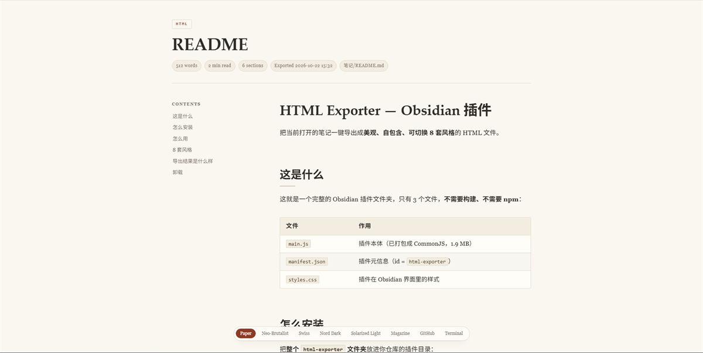

# Typeset（已归档）

> 把 Obsidian 笔记，变成一份好看的网页。

> ⚠️ **本项目已于 2026-10-25 归档**，日常使用请移步继任者 **[Typeset Live](https://github.com/Fogecode/TypesetLive)**——同一套渲染引擎，但**不再需要打开浏览器**：网页效果直接显示在 Obsidian 的标签页里。

---

## 迁移指引：Typeset Live

[Typeset Live](https://github.com/Fogecode/TypesetLive) 与本项目出自同一作者、同一套渲染管线，目标一致——把笔记渲染成排版精美的网页；差别在于**查看方式**：

| | Typeset（本项目，已归档） | [Typeset Live](https://github.com/Fogecode/TypesetLive)（继任者） |
| --- | --- | --- |
| 渲染效果 | 8 套主题 | **完全同一套** |
| 查看方式 | 导出 HTML 文件，另开浏览器查看 | Obsidian 标签页内**直接预览**，不写文件、不开浏览器 |
| 实时性 | 每次手动导出 | 跟随当前笔记自动切换，编辑实时刷新（保持滚动位置） |
| 页内交互 | 主题切换 / 目录 / 复制 | 同款，且**内链点击直接打开对应笔记** |

两者可以同时安装、互不依赖：要把笔记**变成文件发给别人**，继续用 Typeset；要在**写作时实时看网页效果**，用 Typeset Live。

- **新仓库地址：https://github.com/Fogecode/TypesetLive**
- 只想继续使用本项目的导出功能：下载 [v1.1.0 发布包](../../releases)，功能完整可用

## 归档说明

- 仓库保持可用：克隆、构建（`npm install && npm run build`）、安装均正常，仅停止新增功能；安全问题视情况修复。
- 本页为归档版自述；**原始自述文档完整保留在 [docs/README-archived-v1.1.0.md](docs/README-archived-v1.1.0.md)**（含八套主题效果图与完整使用说明）。
- 许可证不变（MIT），代码可继续自由使用与二次开发。

## 它解决什么问题（历史简介）

用 Obsidian 写完东西，常常想分享出去。但导出的 PDF 排版呆板，复制到公众号又丢格式，发 Markdown 原文对方多半看不懂。Typeset 的做法很直接：**把你正在看的那篇笔记，整篇变成一个网页**。打开就是成品，不需要对方装任何东西。八种主题（Paper / Neo-Brutalist / Swiss / Nord Dark / Solarized / Magazine / GitHub / Terminal）的完整介绍见[原始自述](docs/README-archived-v1.1.0.md)。

---

## License

[MIT](LICENSE) · 第三方组件见 [THIRD-PARTY-NOTICES.md](THIRD-PARTY-NOTICES.md)
